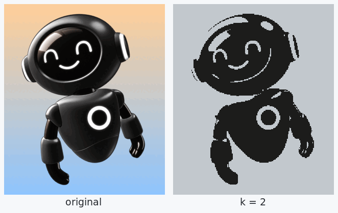
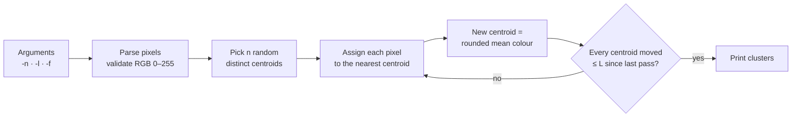

<div align="center">

# Image Compressor: k-means colour quantization in Haskell

**Reduce an image to its *k* most representative colours: every pixel is grouped with the closest colour cluster until the clusters stop moving.**




[Quick start](#quick-start) · [How it works](#how-it-works) · [Team](#team)

</div>

---

## About

Image Compressor is the k-means project of Epitech's second-year functional programming module. The program reads the pixels of an image as text, splits them into *n* colour clusters with the k-means algorithm, and prints every cluster with its final colour and the pixels that belong to it. Replacing each pixel by the colour of its cluster gives the same image with only *n* colours.

It is written in Haskell with Stack, using nothing beyond `base` and `random`.

## Highlights

- **Plain k-means, written from scratch**: random initial centroids, assignment to the nearest centroid, centroid update as the mean colour of the cluster, repeated until convergence.
- **Distinct starting colours**: an initial centroid that is identical to one already picked is drawn again, so no two clusters start on the same colour.
- **Convergence threshold given on the command line**: the loop stops once no centroid moved further than `-l` (Euclidean distance in RGB space) since the previous iteration.
- **Strict input checking**: wrong arguments, a missing or unreadable file, a malformed line or a colour channel outside 0–255 all make the program exit with code 84.

## Quick start

### Prerequisites

[Stack](https://docs.haskellstack.org/en/stable/install_and_upgrade/). It downloads the GHC version pinned by `stack.yaml` (LTS 20.11, GHC 9.2.5) on the first build.

### Build and run

```bash
git clone https://github.com/yanishk/image_compressor.git
cd image_compressor
make            # stack build, then copies the binary to ./imageCompressor
./imageCompressor -n 4 -l 0.8 -f pixels.txt
```

| Option | Meaning |
|--------|---------|
| `-n N` | Number of colours (clusters) to keep |
| `-l L` | Convergence limit: stop when no centroid moves more than `L` |
| `-f FILE` | Input file, one pixel per line |

All three options are required and can be given in any order.

### Input and output

The input has one pixel per line, its position then its colour:

```
(0,0) (33,18,109)
(0,1) (33,18,109)
(0,2) (33,21,109)
(1,0) (240,190,20)
(1,1) (236,188,24)
(1,2) (240,190,20)
```

An image can be turned into this format with ImageMagick:

```bash
convert image.png -depth 8 txt:- | sed -nE 's/^([0-9]+),([0-9]+): *\(([0-9]+),([0-9]+),([0-9]+).*/(\1,\2) (\3,\4,\5)/p' > pixels.txt
```

The output lists each cluster: `--`, the cluster's colour, `-`, then its pixels. With `-n 2 -l 0.8` on the six pixels above:

```
--
(33,19,109)
-
(0,0) (33,18,109)
(0,1) (33,18,109)
(0,2) (33,21,109)
--
(239,189,21)
-
(1,0) (240,190,20)
(1,1) (236,188,24)
(1,2) (240,190,20)
```

The initial centroids are random, so the order of the clusters can change from one run to the next.

## How it works



1. **Initialisation**: each of the *n* centroids takes the colour of a random pixel; a duplicate of an existing centroid is drawn again.
2. **Assignment**: every pixel joins the cluster whose centroid is closest, by Euclidean distance between RGB triples.
3. **Update**: each centroid becomes the mean colour of its pixels, rounded to integers.
4. **Convergence**: steps 2 and 3 repeat until every centroid moved by at most `L` between two passes, then the clusters are printed.

```
app/Main.hs              Entry point: reads the file, runs the algorithm, prints the result
src/GetUserInput.hs      Argument parsing and validation
src/OpenFile.hs          Input parsing into Pixel records and RGB checks
src/Cluster.hs           The k-means algorithm
src/PrintClusters.hs     Output formatting
```

## Team

Built in under two weeks (March 2024) by two Epitech students:

| | Main areas |
|---|---|
| [**Yanis Harkouk**](https://github.com/yanishk) | k-means algorithm (initialisation with distinct centroids, nearest-centroid assignment, rounded centroid update, convergence limit), argument parsing and validation, output formatting, Stack project and Makefile |
| [**Eva Legrand**](https://github.com/Chaegnal) | Input file parsing into pixel records, input validation (RGB range, malformed lines), file error handling, wiring parsing and algorithm together in `main`, readability refactor |

## License

Educational project (Epitech, 2024).
